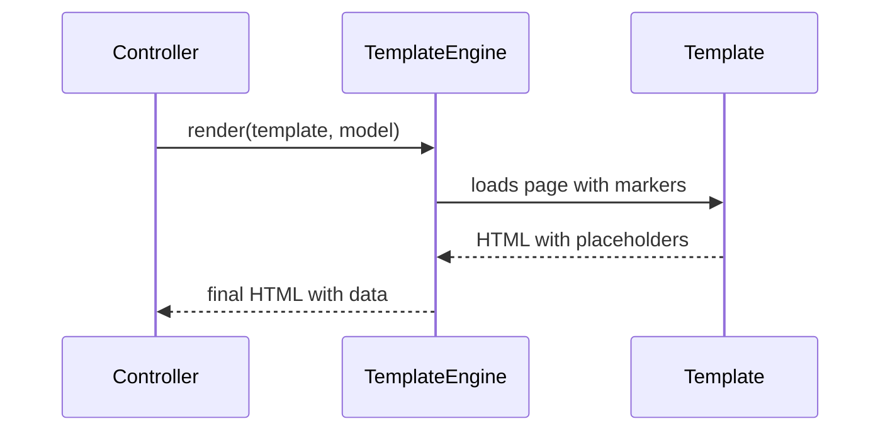

# Template View

## Description

Template View renders information as HTML by embedding markers in a static page. The developer writes the page as if it were ordinary HTML, with spots where dynamic data is inserted, and at run time an engine replaces the markers with the model's values.

The markers can be custom tags, expressions, or, in the more problematic forms, snippets of code (scriptlets). Because the HTML structure is visible in the file, designers can work on the layout directly, which is the pattern's main advantage over generating HTML in code.

## Problems it solves

- Generating HTML by string concatenation in code, which is hard to read and maintain.
- Difficulty for designers to edit the look without touching code.
- The need to see the page structure without running the application.

## When to use

- In web applications that render HTML on the server (SSR).
- When the page has a fixed structure with few dynamic spots.
- When designers and programmers collaborate on the same files.

### When to avoid

- When pages require a lot of presentation logic, which tends to leak into the templates.
- When the same output needs very different formats, in which case Transform View may be better.
- When the look of the entire site needs to change centrally (consider Two Step View).

## Trade-offs

| Benefit | Cost / Risk |
| --- | --- |
| Page structure readable and editable by designers | Business logic and scriptlets can invade the template |
| Fast page development | Hard to test logic embedded in the template |
| Natural separation between controller and view | Changing the global layout requires changing many templates |
| Mature tools and engines available | Run-time errors, often only detected when rendering |

- **Coupling:** the template depends on a simple model; keep it free of business rules.
- **Testability:** rendering tests are heavier than code tests; avoid logic in the template.
- **Performance:** engines usually compile and cache templates, at low cost.

## Diagram



The controller hands the model to the template engine, which loads the page with markers and returns the HTML with the values substituted.

## Example

A page lists a customer's orders. The template contains the HTML and only simple markers; the controller supplies the list.

```html
<!-- orders.html (Thymeleaf) -->
<h1 th:text="${customer.name}">Customer</h1>
<table>
  <tr th:each="o : ${orders}">
    <td th:text="${o.id}">1</td>
    <td th:text="${#numbers.formatDecimal(o.total, 1, 2)}">0.00</td>
  </tr>
</table>
```

JSP, Razor, Thymeleaf, ERB, Jinja, and Blade are Template Views. With the return of SSR and of frameworks like Next.js, Razor Pages, and HTMX, the pattern has become relevant again, even with the predominance of SPAs, which apply the same idea with JSX.

## Related patterns

- [Transform View](/design/poeaa/web-presentation/transform-view) — alternative that transforms data into HTML through code or XSLT, instead of embedding markers.
- [Two Step View](/design/poeaa/web-presentation/two-step-view) — can be built on top of templates to centralize the look.
- [Model View Controller](/design/poeaa/web-presentation/model-view-controller) — Template View is the typical implementation of the view.
- [Page Controller](/design/poeaa/web-presentation/page-controller) — usually chooses and populates the template.
- [Server-side page fragment composition](/architecture/microservices/ui-design/server-side-page-fragment-composition) — composing HTML fragments on the server, in microservices.
- [Template Method](/coding/gof/behavioral/template-method) — layouts with replaceable blocks use a similar idea.

## Reference

- [Pattern page in Fowler's catalog](https://martinfowler.com/eaaCatalog/templateView.html)
- *Patterns of Enterprise Application Architecture*, Martin Fowler (Addison-Wesley, 2002)
