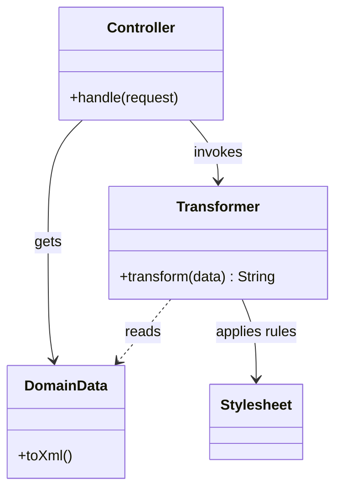

# Transform View

## Description

Transform View is a view that processes domain data element by element and transforms it into HTML (or another format). Instead of starting from a page with markers, it starts from the data and applies transformation rules that say how each type of element should be displayed.

The classic implementation uses XSLT: the model is produced (or converted) as XML, and a stylesheet transforms it into HTML. But the pattern can also be realized with code that walks data structures and converts them, for example JSON serializers or report generators. The flow is data-oriented, whereas Template View is page-oriented.

## Problems it solves

- The need to produce the same information in different formats (HTML, XML, JSON, PDF).
- Difficulty testing presentation logic embedded in templates.
- The risk of domain logic leaking into the view, since the transformation only sees the data it receives.

## When to use

- When the output is generated from structured data, such as XML or JSON.
- When the presentation should be tested as a pure input-output function.
- When the transformation technology (XSLT, serializers) is already standard in the organization.

## When to avoid

- When designers need to edit the HTML directly; Template View is friendlier.
- When the team isn't fluent in XSLT or the transformation language, which has a steep learning curve.
- In pages with a very free-form layout that isn't structured around the data.

## Trade-offs

| Benefit | Cost / Risk |
| --- | --- |
| Transformation testable as an input-output function | Learning curve for XSLT and similar tools |
| Same data source, several output formats | Hard for designers to visualize and edit the page |
| Isolates the view from the web environment | Less visual editing tooling than HTML with markers |
| Keeps domain logic out of the view | Debugging transformations is more laborious |

- **Coupling:** the view depends only on the format of the data, not on the model or the server.
- **Testability:** good; the transformation can be tested with input files and expected output.
- **Performance:** XML transformations can be heavy; compile and cache the stylesheets.

## Diagram



The `Controller` gets the data and invokes the `Transformer`, which applies the `Stylesheet`'s rules to each element and returns the output.

## Example

A list of products in XML is converted into an HTML table by an XSLT stylesheet, with no access to the model.

```xml
<xsl:template match="products">
  <table>
    <xsl:apply-templates select="product"/>
  </table>
</xsl:template>

<xsl:template match="product">
  <tr>
    <td><xsl:value-of select="name"/></td>
    <td><xsl:value-of select="format-number(price, '0.00')"/></td>
  </tr>
</xsl:template>
```

Today the pattern appears mainly as JSON/XML serialization in APIs (Jackson, `System.Text.Json`) and in report generators. In SPAs, the server delivers data and the client transforms it into UI, which is essentially the same idea moved to the browser.

## Related patterns

- [Template View](/design/poeaa/web-presentation/template-view) — page-oriented alternative, with markers in the HTML.
- [Two Step View](/design/poeaa/web-presentation/two-step-view) — can be implemented with two transformations in sequence.
- [Model View Controller](/design/poeaa/web-presentation/model-view-controller) — Transform View is one way to implement the view.
- [Data Transfer Object](/design/poeaa/distribution/data-transfer-object) — the transformed data is usually DTOs or serializable structures.
- [Strategy](/coding/gof/behavioral/strategy) — choosing the transformer according to the output format.

## Reference

- [Pattern page in Fowler's catalog](https://martinfowler.com/eaaCatalog/transformView.html)
- *Patterns of Enterprise Application Architecture*, Martin Fowler (Addison-Wesley, 2002)
