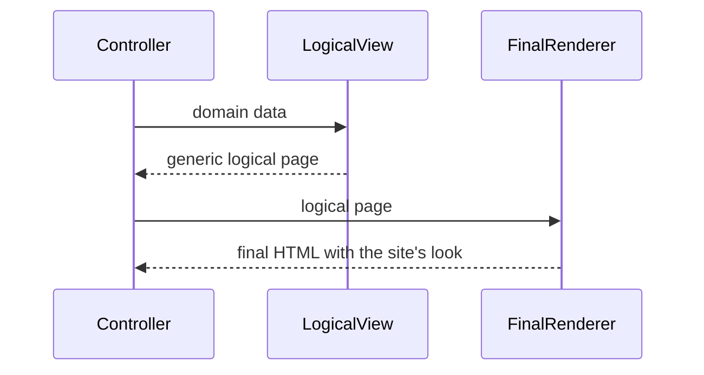

# Two Step View

## Description

Two Step View transforms domain data into HTML in two steps. In the first, a **logical** page is produced, with generic presentation elements (fields, tables, headings, buttons) but no formatting. In the second, that logical structure is converted into the final HTML markup, applying the site's look.

The advantage is that visual decisions are concentrated in the second step. To change the look of the whole site, you only need to change a single place, while the first step stays with each screen, which just describes its content. The pattern also makes it possible to support several looks (for example, for different customers or brands) using a single first step for all of them.

## Problems it solves

- Visual changes that require altering dozens or hundreds of templates.
- Inconsistent looks across screens written by different people.
- The need for multiple themes or brands over the same content.

## When to use

- In sites with many screens that must follow a single, centralized look.
- When multiple looks are needed over the same logical content.
- In large portals and enterprise systems, with dozens of standardized screens.

## When to avoid

- In small sites, where the intermediate layer is a cost with no return.
- When pages have very heterogeneous layouts that don't fit into generic elements.
- When the framework's own layout and component system already solves consistency.

## Trade-offs

| Benefit | Cost / Risk |
| --- | --- |
| Look changed in a single place | Limits screens that deviate from the logical pattern |
| Guaranteed visual consistency | More complexity and one more layer of abstraction |
| Supports several themes over the same content | The intermediate logical language has to be designed and evolved |
| First step independent of HTML | Less tool support than Template View |

- **Coupling:** screens depend on the logical vocabulary, not on the final HTML.
- **Consistency:** the pattern's main reason for being.
- **Complexity:** high compared to Template View; only pays off at scale.

## Diagram



The first step transforms the data into a logical presentation structure; the second converts it into HTML with the site's look.

## Example

Each screen returns a logical structure; a single renderer converts everything into HTML with the company's style.

```typescript
type LogicalPage = { title: string; fields: { label: string; value: string }[] };

// Step 1: screen-specific
const customerScreen = (c: Customer): LogicalPage => ({
  title: `Customer ${c.name}`,
  fields: [{ label: "E-mail", value: c.email }, { label: "City", value: c.city }],
});

// Step 2: single for the whole site
const renderSite = (p: LogicalPage): string => `
<main class="brand-theme">
  <h1>${p.title}</h1>
  <dl>${p.fields.map(f => `<dt>${f.label}</dt><dd>${f.value}</dd>`).join("")}</dl>
</main>`;

const html = renderSite(customerScreen(customer));
```

In practice, the pattern shows up in master layouts, design systems, and component libraries (Razor layouts, Rails layouts, Storybook with React components). In SPAs, generic components play the role of the second step.

## Related patterns

- [Template View](/design/poeaa/web-presentation/template-view) — the second step can use templates, or the pattern can be used at each step.
- [Transform View](/design/poeaa/web-presentation/transform-view) — two transformations in sequence (for example, two XSLTs) realize the pattern.
- [Model View Controller](/design/poeaa/web-presentation/model-view-controller) — Two Step View is one way to structure the view.
- [Client-side UI composition](/architecture/microservices/ui-design/client-side-ui-composition) — composing the UI from components in distributed architectures.
- [Decorator](/coding/gof/structural/decorator) — the second step "decorates" the logical page with the site's look.

## Reference

- [Pattern page in Fowler's catalog](https://martinfowler.com/eaaCatalog/twoStepView.html)
- *Patterns of Enterprise Application Architecture*, Martin Fowler (Addison-Wesley, 2002)
